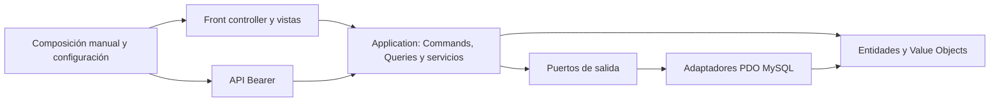

# Arquitectura y decisiones técnicas

## Línea base y sistema implementado

El repositorio parte del ejemplo docente de CRUD de usuarios. La implementación del ejercicio 11 conserva el front controller PHP, el cargador de clases propio y las capas `Domain`, `Application`, `Infrastructure` y `Common`; no introduce Composer ni un framework. En el sistema actual hay pruebas unitarias (`tests/run.php`), pruebas MySQL opcionales (`tests/integration.php`), migraciones versionadas y una API JSON. Los datos históricos de archivos, pruebas y esquema de la línea base no describen el sistema implementado.

## Límites

- **Domain:** reglas, entidades, value objects y eventos; no conoce HTTP ni PDO.
- **Application:** casos de uso, Commands/Queries y puertos.
- **Infrastructure:** adaptadores MySQL, controlador web/API, correo y configuración.
- **Presentation:** vistas PHP, CSS y JavaScript sin consultas ni reglas de negocio.
- **Common:** composición manual y carga de clases, manteniendo el enfoque existente sin introducir un framework.

## DDD, SOLID y CQRS en el alcance real

- **DDD:** `Celular`, `UserModel`, `Imei` y Value Objects representan conceptos y validaciones del dominio. Las entidades no dependen de PDO ni del protocolo HTTP.
- **CQRS:** los Commands representan escrituras y Queries lecturas; sus casos de uso quedan separados. Se ejecutan como servicios PHP simples, sin buses, mediadores ni proyecciones distribuidas.
- **SOLID:** los controladores traducen transporte a llamadas de aplicación; los servicios usan puertos (`DIP`); adaptadores implementan esos puertos. Interfaces pequeñas separan guardar, actualizar, consultar y eliminar (`ISP`). Las políticas de roles se centralizan en `RolePermissions`. Es una aplicación pragmática en el código existente, no una certificación formal de cada principio.

La inyección de dependencias se compone manualmente en `Common/DependencyInjection.php`; la conexión PDO se memoiza durante la petición para que los adaptadores compartan una conexión por request.

Las lecturas se modelan como queries y las escrituras como commands. Es una separación de objetos y casos de uso, no una infraestructura de buses CQRS. Los controladores web y API comparten los casos de uso y sus puertos de persistencia.

## Decisiones para el ejercicio 11 — Celular

La entidad `Celular` conserva los 20 nombres de atributos indicados por el ejercicio; el ID es técnico y adicional. `imei` es una colección de uno o dos identificadores, alineada con `cantidadSim`. Se persiste en una tabla hija normalizada para admitir búsquedas y unicidad por identificador físico sin guardar dos IMEI concatenados en una columna. Cada IMEI es único globalmente porque identifica una interfaz celular concreta; un teléfono dual SIM tiene dos IMEI distintos y ambos apuntan al mismo celular. Se valida que la cantidad de IMEI coincida con `cantidadSim` (1 o 2).

`wifi`, `bluetooth`, `nfc`, `huella`, `ir` y `resisteAgua` son booleanos. `pulgadas`, `megapixeles` y `velocidadCpu` son decimales de precisión fija. `ram`, `almacenamientoPrincipal`, `almacenamientoSecundario`, `camaras` y `cantidadSim` son enteros; almacenamiento secundario puede ser cero cuando no tiene ranura/expansión. Las unidades de capacidad se expresan en GB y la velocidad CPU en GHz.

## Roles y compatibilidad

Roles objetivo: `ADMIN`, `SUPERVISOR`, `OPERADOR` y `CONSULTA`. `ADMIN` administra usuarios, configuración y todo el catálogo; `SUPERVISOR` administra celulares y consulta usuarios; `OPERADOR` crea, consulta y actualiza celulares; `CONSULTA` solo consulta. Los valores legados `MEMBER` y `REVIEWER` se interpretan como `OPERADOR` y `CONSULTA` durante la transición para no bloquear cuentas existentes. Los formularios nunca deciden el rol permitido: se verifica en servidor.

El alta inicial de administrador se realiza con un comando CLI de bootstrap, no con un registro público que permita escalar privilegios. Las migraciones se entregan, pero no se ejecutan automáticamente contra bases existentes.

## Compatibilidad y límites operativos

Se toma PHP 8.3 como mínimo por lo declarado en el README. Dockerfile y CI configuran PHP 8.3; CI declara MySQL 8.4. La migración inicial exige MySQL 8.0.16+ para que el servidor aplique restricciones `CHECK`. En esta revisión se confirmó un servicio Windows MySQL 26.7.0 en puerto configurado 3306, pero no hubo credenciales para autenticar, inspeccionar bases ni ejecutar integración. Docker no está instalado/disponible en PATH; no se afirma que imagen o contenedores funcionen.

## Flujo de dependencias

